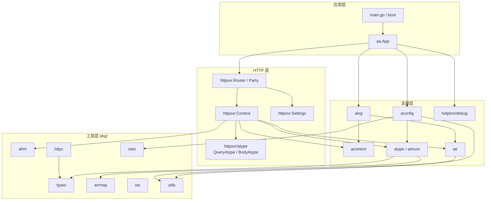
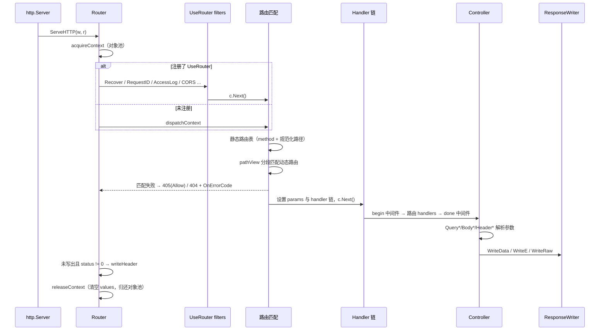
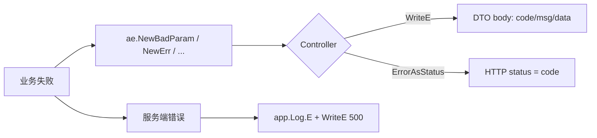

# 架构总览

## 1. 设计目标

| 目标 | 落地方式 |
|------|----------|
| 标准库优先 | HTTP 栈完全基于 `net/http`，Router / Context / 响应写出都是自实现 |
| Controller 友好 | 一个 `*httpsvr.Context` 提供参数解析、校验、错误、DTO 写出 |
| 多 App 同进程 | 一个 `*httpsvr.Router` 可挂多个 `Party`（业务 App），成熟后再拆分 |
| 统一的错误语义 | 业务错误使用 `*ae.Error`，HTTP 状态码可选（`ErrorAsStatus`） |
| 配置与发现 | `aconfig` 负责 YAML / 环境 / 文本密钥 / Consul 注册与发现 |
| 类型安全 | `atype` 提供金额、日期、版本、区划、分页等业务类型，`httpsvr/atype` 提供解析命名空间 |

## 2. 分层结构



### 依赖方向约束

- `pkg/*` **不依赖** `aa/*`，可被任何项目复用。
- `aa/httpsvr` 不依赖 `aconfig`；配置通过 `Router.UseHooks(app.HTTP)` 注入的是 `*httpsvr.Settings`，而不是配置对象。
- `aa/atype` 只依赖 `pkg/*` 与 `ae`；`ae` 只依赖 `pkg/*` 与 `acontext`。
- `aa`（根包 `app.go`）是唯一把配置、日志、HTTP、全局 context 组装起来的包。

## 3. 包职责

| 包 | 职责 | 关键符号 |
|----|------|----------|
| [`aa`](../aa/app.go) | 应用装配：Config / Log / HTTP Settings / 全局 context | `App`、`New`、`WithLog`、`Check`、`CheckErrors` |
| [`aa/httpsvr`](../aa/httpsvr) | 路由、中间件、请求解析、DTO 响应、静态资源与视图 | `Router`、`Party`、`Context`、`Settings`、`CORS` |
| [`aa/httpsvr/atype`](../aa/httpsvr/atype) | `ctx.QueryAtype` / `ctx.BodyAtype`（`atype`、`aenum` 参数） | `Query`、`Body`、`QuerySource`、`BodySource` |
| [`aa/aconfig`](../aa/aconfig) | YAML 配置、环境、文本配置、Consul | `Config`、`Env`、`Readonly`、`Config.RegisterGRPCService` |
| [`aa/acontext`](../aa/acontext) | 请求上下文适配、Trace、IP、健康状态 | `Context`、`Bind`、`TraceInfo`、`ServHealth` |
| [`aa/ae`](../aa/ae) | 业务错误码与 `*ae.Error` | `NewBadParam`、`Error`、`Text`、`First` |
| [`aa/alog`](../aa/alog) | 日志接口与默认实现 | `LogInterface`、`NewDefaultLog` |
| [`aa/atype`](../aa/atype) | 业务类型与枚举 | `Atype`、`Money`、`Date`、`Paging`、`aenum` |
| [`aa/helpers/debug`](../aa/helpers/debug) | 日志落盘、pprof | `LogWriter`、`Profile` |
| `pkg/*` | 无框架状态的工具 | `afmt`、`types`、`arrmap`、`httpc`、`ios`、`nets`、`utils`、`basic` |

## 4. 请求生命周期



关键点：

1. **Context 复用**：`sync.Pool` 复用 `*Context`，`releaseContext` 会 `clear` 值袋后整体重置结构体；不要在处理器里保存 `*Context` 到 goroutine。
2. **静态路由 O(1)**：注册时把无参数路由写入 `staticRoutes[method][规范化路径]`。
3. **动态路由**：每个请求只构造一次 `pathView`（内联保存最多 16 段边界），逐路由比较，不再为每个路由重新切分路径。
4. **路径参数可见性**：匹配成功后设置 `c.params` 并重置 `paramsInjected`，保证 `Query*` 也能读到路径参数（详见 [httpsvr.md](./httpsvr.md#路径参数与查询参数)）。
5. **错误输出**：路由层只负责 404/405；业务错误由 Controller 通过 `WriteE` 输出。

## 5. 启动流程（推荐）


对应代码骨架：

```go
cfg, err := aconfig.New(cfgPath, nil)
ctx, cancel := acontext.WithCancel(acontext.Background())
app := aa.New(ctx, cancel, cfg).
	WithLog(alog.NewDefaultLog(alog.LevelInfo))

rt := httpsvr.NewRouter()
rt.UseHooks(app.HTTP)
rt.UseRouter(httpsvr.Recover, httpsvr.RequestID)
// ... 注册路由

acontext.SetServReady()
err = rt.Listen(":8080")
```

`Router.Listen` 内部持有 `*http.Server`，`Router.Shutdown(ctx)` 做优雅退出并返回 `nil`（`http.ErrServerClosed` 被吞掉）。

## 6. 并发与对象池

| 对象 | 池化 | 说明 |
|------|------|------|
| `*httpsvr.Context` | `sync.Pool` | 每请求一次；复用 `Values` 的 map |
| `*atype.Atype` | `sync.Pool` | `atype.New` 取用，`Close` / `Release*` 归还 |
| `*RawValue` | 否 | 轻量包装，随请求分配 |

约束：

- **路由注册必须在开始服务之前完成**。`Router` 的 `byMethod` / `staticRoutes` / `routerFilters` 没有写锁；并发注册会产生数据竞争。
- `Router.mu` 只保护 `srv` 指针（`Listen` / `Shutdown`）。
- `Config` 的读取在写期间通过 `cfgMtx` 保护；`Reload` / `Extend` 用 `onWrite` 自旋互斥。
- 健康状态使用 `atomic.Value`。

## 7. 错误模型



- `*ae.Error` 字段：`Code`、`Msg`、`Caller`、`Detail`、`TraceInfo`。
- 常量错误通过 `Lock()` 冻结，修改时会自动 `Clone`，可安全跨 goroutine 复用。
- `*ae.Error` 故意**不实现** `error` 接口，避免误用；需要字符串时用 `String()` / `Text()` / `Trace(ctx)`。
- `ae.IsNotFound(err)` 兼容标准 `error` 与 `*ae.Error`。

## 8. 扩展点

| 扩展点 | 位置 | 用途 |
|--------|------|------|
| `Router.UseRouter` | 匹配前 | CORS、Recover、RequestID、访问日志、限流 |
| `Party(prefix, mw...)` / `Use` / `Done` | 匹配后 | 鉴权、审计、事务钩子（done 需 `Next`） |
| `OnErrorCode` / `OnAnyErrorCode` | 404/405 等 | 统一错误页或 JSON 错误体 |
| `httpsvr.Settings` | `UseHooks` | Content-Type 集合、错误处理器、序列化器、`BeforeSerialize` |
| `Context.WithSerialize` / `WithErrorHandler` | 单请求 | 单接口覆盖全局策略 |
| `alog.LogInterface` | `App.WithLog` | 接入 zap / zerolog 等 |
| `aconfig` `valueProcessor` | `aconfig.New` | 配置值解密、占位符替换 |
| `aconfig/consul` | `SetConsul` | gRPC resolver / 服务发现 |

## 9. 目录结构

```
aago/
├── airis.go              # 根包文档（package aago）
├── aa/
│   ├── app.go            # App 装配
│   ├── aconfig/          # 配置 + Consul + resolver
│   ├── acontext/         # std context 适配、健康、IP
│   ├── ae/               # 错误码
│   ├── alog/             # 日志
│   ├── atype/            # 业务类型（含 aenum）
│   ├── helpers/debug/    # 日志落盘、profile
│   └── httpsvr/          # HTTP 框架（含 atype 命名空间）
├── pkg/                  # 工具包（不依赖 aa）
├── doc/                  # 本目录
└── .github/skills/       # aago-framework skill
```
